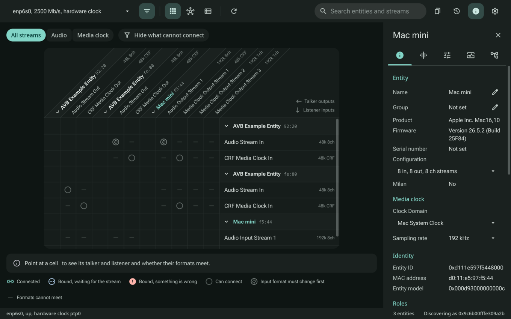
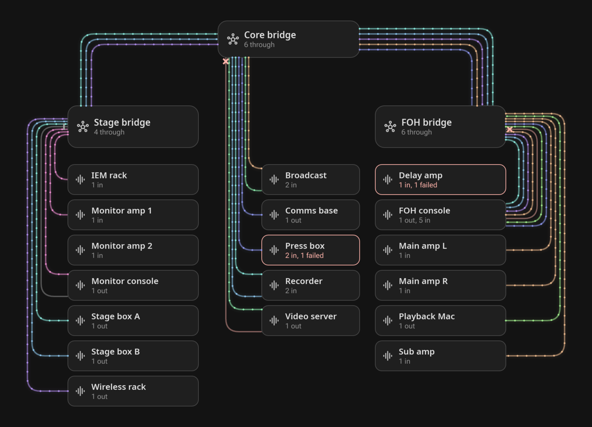
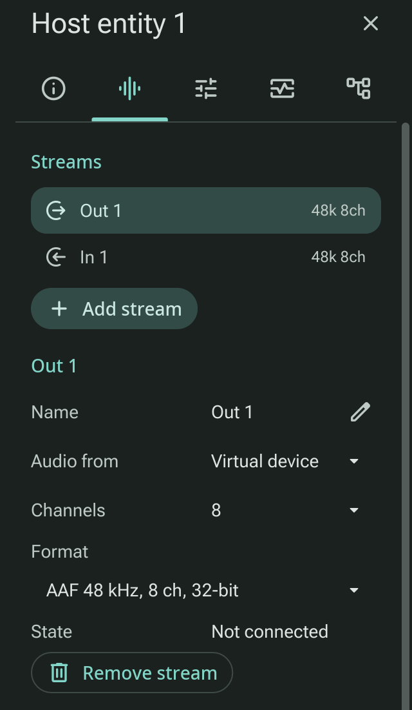
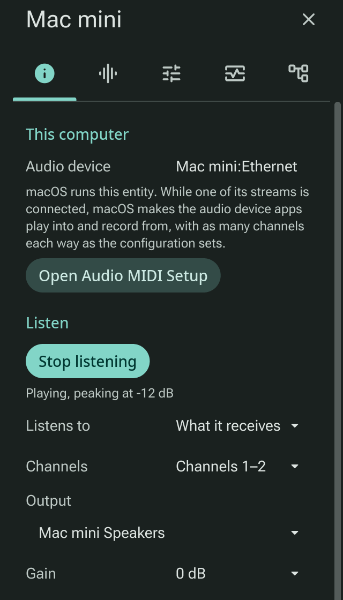

# triib

A lightweight ATDECC (IEEE 1722.1) controller with Milan and AVB Lite
support, for Linux, Windows and macOS. On a computer with a hardware
timestamping Ethernet interface it will also run its own talkers and
listeners, routed to the computer's audio. Built in Rust with
[iced](https://iced.rs), sharing its look with
[prev](https://github.com/scrambletools/prev) through
[scramble-ui](https://github.com/scrambletools/scramble-ui).

Website: **[triib.run](https://triib.run)**, with
[a tour](https://triib.run/guide.html) and
[the specifications](https://triib.run/specs.html).

> **Status:** 1.0.0. On Linux, macOS and Windows, triib discovers ATDECC entities, reads their
> entity models (names, streams, clocks, Milan support) and keeps them for
> next time, shows and changes stream connections in a matrix, maps the
> network from each entity's gPTP path, identifies entities, renames
> them, changes their configurations, stream formats, sampling rates,
> clock sources (each entity's media clock right in the entity list) and
> outputs' max transit times, lists a talker's listeners, shows and
> changes how their channels map to streams, shows and sets their
> controls, such as gain and mute, saves and recalls presets of all of
> that and the connections, logs every ATDECC frame sent and heard,
> marking those that break the rules, and shows how entities run AVB
> Lite, what their streams take of each link and the alarms the AVB Lite
> profile calls for, and what Wi-Fi stations and access points report
> under [AVB Wireless](https://github.com/avbcommunity/profiles/blob/main/avb_wireless.md),
> each station under its access point in the network view. AI agents can
> use it through `triib --mcp`. On Linux it runs entities on the local
> host, Milan entities with any number of streams each way: AAF or AM824 audio
> at 48, 96 or 192 kHz to and from the computer's audio devices, each
> stream with its own virtual audio device by default, and CRF media
> clock streams, any input the entity's clock source. On a Mac it shows
> the Mac's own AVB entity as a host entity, and plays what that entity
> receives or sends through an output picked. It speaks 38 languages,
> following the system's or the one picked in Settings. See the
> [plan](docs/PLAN.md).





## Installing

[Releases](https://github.com/scrambletoolsllc/triib/releases) have
packages for Linux on x86_64, ARM64 and RISC-V, Windows on x64 and ARM64,
and macOS on Apple Silicon, each setting up what triib needs to send and
receive raw Ethernet:

| System | Package | What it sets up |
|---|---|---|
| Linux | .deb, .rpm, PKGBUILD | `CAP_NET_RAW` for `triib`, `triib-cli` and `triib-endpointd` |
| Linux | .tar.gz | nothing: run `sudo setcap cap_net_raw+ep` on the three programs |
| macOS (Apple Silicon) | .pkg | access to `/dev/bpf*` for the user installing it, at every start, as Wireshark's ChmodBPF does; `triib-cli` in /usr/local/bin |
| Windows | .msi, .zip | nothing itself: install [Npcap](https://npcap.com) first, which the installer and triib point to when it is missing |

On macOS, triib reaches the Mac's own AVB entity through Apple's
AudioVideoBridging framework, as the system never hands that entity the
commands a program writes to BPF; see [the Mac's own entity](#the-macs-own-entity).
[docs/RELEASING.md](docs/RELEASING.md) has the details.

## Host entities

On Linux, the Entities view adds entities running on the local host,
which `triib-endpointd` runs, on a wired interface with a PTP hardware clock
(`ethtool -T <interface>` shows one). Installing the package is all
they take. They need [linuxptp](https://linuxptp.nwtime.org)'s `ptp4l`
running gPTP on that interface, so the clock keeps the network's time,
and where none runs there the daemon starts triib's own unit for it,
`triib-ptp4l-gptp@<interface>`; a ptp4l run another way stays as it is.
triib reads ptp4l's state through its read-only socket,
`/var/run/ptp4lro`, and says when ptp4l isn't there. triib opens with
the host entities listed for its interface back on the network, starting
the daemon. Each is a Milan
entity with any number of streams each way, which controllers,
triib among them, bind like any other. Add entity adds one with an
audio stream each way, and the inspector's Streams tab adds and removes
streams: audio streams of AAF or AM824 at 48, 96 or 192 kHz, 8 channels
unless it picks another count, each by default with a virtual audio
device of its own that apps play into or record from, or a test tone,
silence or one of the computer's devices; and media clock streams of
CRF. Any input can be the entity's clock source, its talkers then
following the clock recovered from that stream. Talkers take their
stream addresses with MAAP, and the stream threads ask RealtimeKit for
real-time scheduling, as PipeWire does.



The entities are listed in `entities.toml` in triib's data folder
(`~/.local/share/triib` on Linux), or in another file Settings, Storage
name, which the app writes and the daemon reads again whenever it
changes;
the names, formats, bindings, clock sources and mappings controllers
give are kept in it, so an input binds again after a restart, and
presets keep it too:

```toml
interface = "enp2s0"
ptp4l_socket = "/var/run/ptp4lro"

[[endpoint]]
instance = 0
name = "Host entity 1"

[[endpoint.stream]]
direction = "out"
channels = 8          # audio "virtual" when left out: its own virtual device

[[endpoint.stream]]
direction = "in"
channels = 2
audio = "default"     # or "discard", or an output's name

[[endpoint.stream]]
direction = "in"
clock = true          # a media clock stream
clock_source = true   # which the entity follows
```

triib 1.0's `endpoints.toml` moves to `entities.toml`, and its talkers
and listeners, `kind = "talker"` and `kind = "listener"` entries, read
as entities of their one stream.

Where no AVB bridge answers on the interface, the entities fall back to
[AVB Lite](https://github.com/avbcommunity/profiles/blob/main/avb_lite.md),
a working if degraded path over switches that are not AVB bridges: CVU
SRP declarations in place of MSRP, and streams unicast to each listener.
At the top of the file:

- `avb_lite = "off"` keeps them on AVB, and `"on"` puts them on AVB Lite
  from the start.
- `unicast_fanout` sets how many listeners a talker serves unicast, 2 if
  not given. A listener beyond that is refused with Talker Failed,
  unless `multicast_escalation = true` lets the talker move the stream
  to multicast, which non-AVB switches flood to every port; allow it
  only where the media VLAN is confined. Controllers can set it too
  (`triib-cli lite-config`).
- `media_vlan` sets the VLAN of AVB Lite's streams, 2 if not given, or 0
  for a priority tag only on switches whose VLANs cannot be set up.

ptp4l cannot switch to AVB Lite's PTP profile by itself. The Linux
packages install `triib-ptp4l-gptp@<interface>` and
`triib-ptp4l-lite@<interface>` units and a polkit rule that lets the
person at the computer start them; the daemon starts the gPTP one where
no ptp4l runs, moves ptp4l to the AVB Lite profile when its entities
fall back, and back when the link comes up again. Both configurations
step the clock when it is a second or more off, as after a driver resets
the card's clock: igb does on an I210 when its link goes down and up.
To have ptp4l run from boot rather than from the daemon's start,
`systemctl enable --now triib-ptp4l-gptp@enp2s0`.

AVB Lite also asks for Energy-Efficient Ethernet and PAUSE off the
interface's link. The `triib-link@<interface>` unit turns them off with
`ethtool`; the ptp4l units pull it in, or
`systemctl enable --now triib-link@enp2s0` runs it at every boot.
Where a card filters VLANs in hardware, as the I210 does, a stream's
socket takes the interface promiscuous, as the card would otherwise drop
every stream frame, tagged with its VLAN. Where
it changes them on an interface that is up, it takes the interface down
and up again, as some drivers keep PTP from working after the change
otherwise. Should they come back on, as after the driver starts again,
the daemon runs the unit once more. Some drivers, atlantic's among them
(Aquantia cards), also keep their time stamps on received PTP frames
after the link renegotiates, as when a cable goes back in, and ptp4l
drops every frame until the interface goes down and up; the daemon sees
them and restarts the interface through `triib-link-reset@<interface>`.

The daemon runs MSRP and MVRP once for the port, for all its entities,
as MRP runs per port: two participants on one point-to-point port do not
hear each other's Leave, so one withdrawing VLAN 2 would take it from the
bridge while the other still needs it. So one daemon runs on an interface
whichever user starts it, and triib says when another user's holds it, or
when another program on this computer declares MSRP or MVRP on the port.

## The Mac's own entity

On a Mac with AVB turned on in Audio MIDI Setup's Network Device Browser,
triib shows the Mac's own AVB entity as a host entity, in the entity
list and the network view. Its inspector names the Core Audio device
apps play into and record from, which macOS makes only while one of the
entity's streams is connected, and opens Audio MIDI Setup. The entity's
configurations are picked by name, as any entity's are. Where AVB is
off, the Entities view says where to turn it on.



Listen plays a channel or a pair of what the entity receives, or of what
apps send to one of its output streams, through an output picked, with
a gain. Hearing what it sends takes a Core Audio tap, which macOS 14.2
and later have; on older systems Listen offers what it receives alone
and says why. macOS asks once for the microphone, to hear what the Mac
receives, and for audio recording, to hear what it sends. The audio
plays in a helper, `triib --monitor`, which triib starts again should it
end or hang, and which waits for a device that is not there yet; the
choice is kept across restarts. AI agents set it through the
`set_audio_monitor` tool.

## Using triib with AI agents

`triib --mcp` serves the Model Context Protocol on stdin and stdout, so
an agent such as Claude Code can see and change the network through the
triib on your desktop, which it starts when it is not running. To add it
to Claude Code:

```sh
claude mcp add triib -- triib --mcp
```

The tools read what triib knows (its status, the entities, an entity's
streams, formats and clocks, the connections) and change what a click
would: connecting and disconnecting streams, setting a stream's format, a
sampling rate or a clock source, renaming and identifying, and routing an
audio input on this computer to an output with the audio monitor, as the
Mac's own AVB entity's Listen controls do. A change
answers once the device has, with what it said. The first time an agent
connects, triib asks whether to let it in; Settings lists the agents
allowed and has a switch to turn outside control off.

## Building

```
git clone https://github.com/scrambletoolsllc/triib
cd triib
cargo run -p triib          # the app
cargo run -p triib-cli -- interfaces
cargo run -p triib-cli -- discover <interface>
cargo run -p triib-cli -- describe <interface> [entity-id]
cargo run -p triib-cli -- network <interface>
cargo run -p triib-cli -- name <interface> <entity-id> <entity|group|type:index> <name>
cargo run -p triib-cli -- format <interface> <entity-id> <stream-input:N|stream-output:N> <hex>
cargo run -p triib-cli -- rate <interface> <entity-id> <audio-unit> <hertz>
cargo run -p triib-cli -- clock <interface> <entity-id> <clock-domain> <clock-source>
cargo run -p triib-cli -- clocks <interface>
cargo run -p triib-cli -- maps <interface> [entity-id]
cargo run -p triib-cli -- map <interface> <entity-id> <add|remove> <stream-port-input:N|stream-port-output:N> <stream:channel=cluster:channel>...
cargo run -p triib-cli -- controls <interface> [entity-id]
cargo run -p triib-cli -- control <interface> <entity-id> <control> <value>...
cargo run -p triib-cli -- connect <interface> <talker-id>:<output> <listener-id>:<input>
cargo run -p triib-cli -- disconnect <interface> <listener-id>:<input>
cargo run -p triib-cli -- disconnect-talker <interface> <talker-id>:<output> <listener-id>:<input>
cargo run -p triib-cli -- configuration <interface> <entity-id> <configuration>
cargo run -p triib-cli -- identify <interface> <entity-id> [seconds]
cargo run -p triib-cli -- streams <interface> <entity-id>
cargo run -p triib-cli -- lite <interface> <entity-id> [seconds]
cargo run -p triib-cli -- lite-config <interface> <entity-id> <avb-interface> <on|off>
cargo run -p triib-cli -- wireless <interface> <entity-id>
cargo run -p triib-cli -- wireless-config <interface> <entity-id> <avb-interface> <on|off>
cargo run -p triib-cli -- transit <interface> <entity-id> <output> [nanoseconds]
cargo run -p triib-cli -- descriptor <interface> <entity-id> <type:index>
cargo run -p triib-cli -- harvest <interface> <entity-id> [repeat]
cargo run -p triib-endpointd -- [--config <entities.toml>] [--interface <interface>]
```

triib uses [scramble-ui](https://github.com/scrambletools/scramble-ui)
at the revision `Cargo.toml` pins, as prev does. To change both together,
clone scramble-ui beside triib and build with
`cargo --config .cargo/scramble-ui-local.toml build`, a git-ignored file
pointing at that checkout (for clippy and test, put `--config` after the
subcommand):

```toml
[patch."https://github.com/scrambletools/scramble-ui"]
scramble-ui = { path = "../scramble-ui" }

[patch.crates-io]
iced_graphics = { path = "../scramble-ui/vendor/iced_graphics" }
iced_widget = { path = "../scramble-ui/vendor/iced_widget" }
```

Once the scramble-ui change is pushed, move the pin to its revision and
build once without the file, so `Cargo.lock` names the revision again.

On Linux, sending and receiving ATDECC frames needs `CAP_NET_RAW`:

```
sudo setcap cap_net_raw+ep target/debug/triib
sudo setcap cap_net_raw+ep target/debug/triib-endpointd
```

Building on Linux needs ALSA's and PipeWire's headers for audio, and
clang for PipeWire's bindings (`libasound2-dev`, `libpipewire-0.3-dev`
and `libclang-dev` on Debian and Ubuntu; `alsa-lib-devel`,
`pipewire-devel` and `clang-devel` on Fedora; `alsa-lib`, `libpipewire`
and `clang` on Arch).

On macOS it needs access to `/dev/bpf*`, as Wireshark's ChmodBPF or
triib's package gives (or, until the next restart,
`sudo chown $USER /dev/bpf*`). It reaches the Mac's own AVB entity
through Apple's AudioVideoBridging framework, as the system never shows
that entity what a program writes to BPF. On Windows it needs
[Npcap](https://npcap.com). `cargo run -p triib-cli -- interfaces` says
whether raw Ethernet is ready.

## Workspace

| Crate | What it does |
|---|---|
| `triib` | The app |
| `triib-cli` | Headless controller |
| `triib-endpointd` | Runs the host entities |
| `triib-stream` | AAF streams, the media clock and audio devices |
| `triib-pipewire` | Virtual audio devices as PipeWire nodes |
| `triib-store` | Settings and cache files |
| `atdecc` | IEEE 1722.1 ATDECC with Milan: frames and state machines, no I/O |
| `avb-mrp` | IEEE 802.1Q MRP, MSRP and MVRP: frames and state machines, no I/O |
| `avb-net` | Raw Ethernet, interfaces and hardware timestamps per operating system |

`atdecc`, `avb-mrp` and `avb-net` are meant for other applications too:
they depend on nothing but `avb-net` (and, for `atdecc`'s driver on
macOS, the AudioVideoBridging framework), do no I/O of their own outside
that optional platform support, and build without std for
microcontrollers.

## License

Licensed under either of [Apache License, Version 2.0](LICENSE-APACHE) or
[MIT license](LICENSE-MIT) at your option. Unless you explicitly state
otherwise, any contribution intentionally submitted for inclusion in triib
by you, as defined in the Apache-2.0 license, shall be dual licensed as
above, without any additional terms or conditions.

Milan and AVB are trademarks of Avnu Alliance. triib is not certified by
Avnu Alliance.
